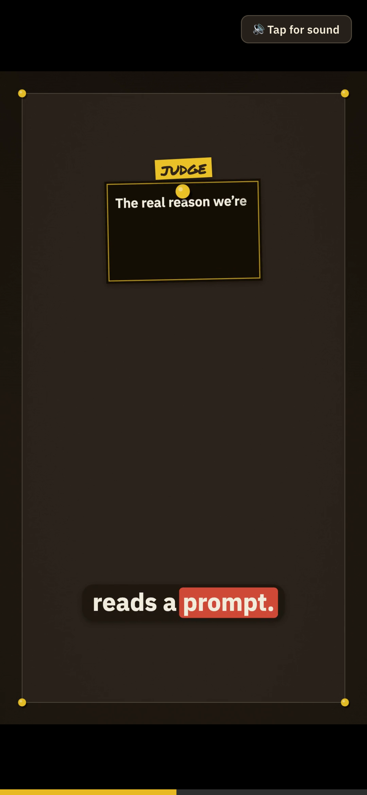
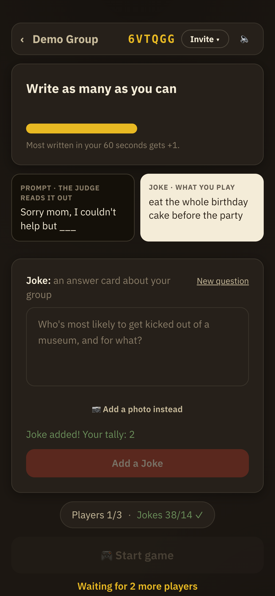
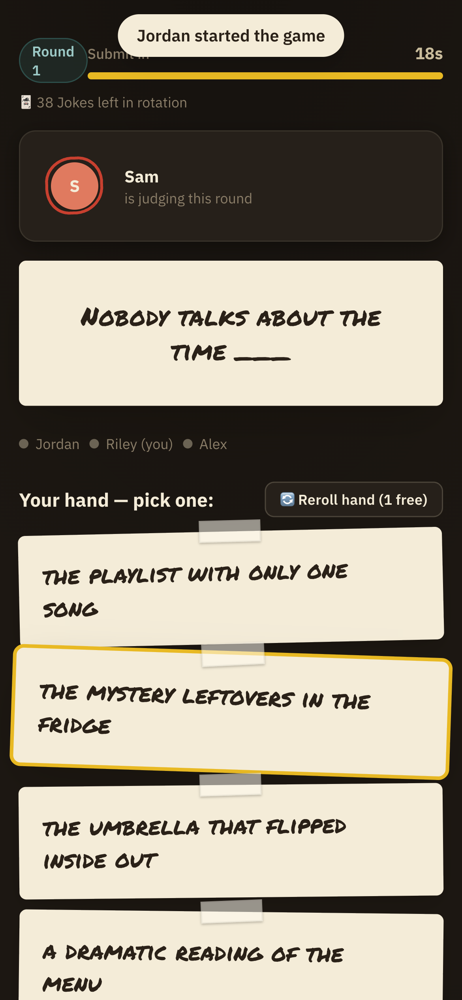
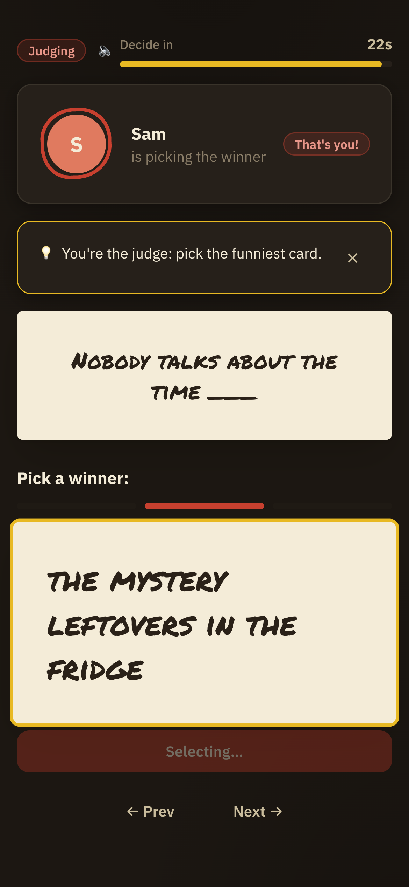
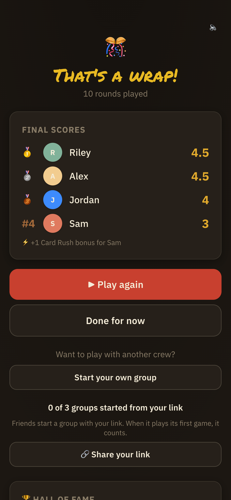
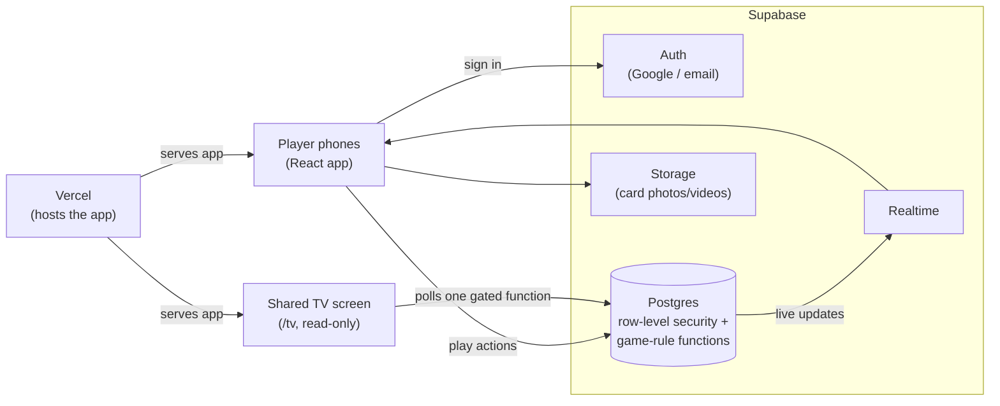

# Inside Joke

**Play it: https://insidejoke.vercel.app**

A live party game for friend groups. Everyone writes jokes about the group on their phone, the jokes get shuffled into one deck, and players take turns judging which one best fits a prompt. A shared TV screen shows the game to the whole room.

About 22 players have played 300+ rounds so far.

## How to play (24-second video)

https://github.com/user-attachments/assets/41b5f5db-163d-4216-b063-7565110fbf34

## How it plays

1. **Join.** One person starts a group. Friends join with a code or QR code shown on the TV. New players watch a 24-second how-to-play video and a short rules screen.
2. **Write (Card Rush).** Everyone gets 60 seconds to write jokes about the group. Whoever writes the most gets 1 bonus point.
3. **Shuffle.** All the jokes go into one deck and get dealt out, so your hand mixes everyone's jokes.
4. **Play.** Each round, a judge reads a prompt and everyone else plays a joke from their hand. Cards are shown with no names.
5. **Pick.** The judge picks a winner. The player who played it gets 1 point, and whoever wrote it gets half a point. Then a new judge takes over.

## Screenshots

| Join (how-to-play video) | Write | Play | Judge | Recap |
|---|---|---|---|---|
|  |  |  |  |  |

Screenshots use a test group with made-up names and jokes.

## What I built and how

I designed the game and built it by directing Claude Code. I decided what each change should do, reviewed every change before it shipped, and tested it in real games. As of November 2026 the project has 142 commits and 77 database migrations.

The parts I'd point to:

- **Game rules run in the database, not the browser.** Dealing, submitting, picking a winner and timers run as Postgres functions. A player can't see someone else's hand or force a result by editing the page.
- **Row-level security.** Only members of a group can read that group's jokes. I found and closed a leak where game content was readable through public reads. The TV now gets its state from one locked-down function that returns only what the screen needs, and only shows cards during judging.
- **Realtime without a custom server.** Phones stay in sync through Supabase Realtime (database changes pushed over websockets). I also fixed reconnects so phones that drop off don't flood the server when they come back.

## Architecture

## Stack

- **Frontend:** React + Vite, Tailwind CSS, hosted on Vercel
- **Backend:** Supabase: Postgres with row-level security, Auth, Realtime, Storage
- **Built with:** Claude Code

## What I learned from real players

- **Fun has to start immediately.** New players got stuck on confusing setup screens before they'd played anything. Joining now takes you through a 24-second video and a short rules screen, then straight into Card Rush, the 60-second joke-writing sprint.
- **Nobody reads the rules.** Players didn't understand how the game worked, and almost nobody read the written rules. I made a 24-second narrated how-to-play video (my own voice and captions, built in code) that plays when you join and loops on the TV in the lobby. The rules screen after it now covers only what the video doesn't.
- **Writers deserve credit.** Players felt it was unfair that the person who wrote a winning joke got nothing. Now the player who plays it gets 1 point and the writer gets half a point.
- **Volume shouldn't beat quality.** Card Rush used to give a point for every joke you wrote, so writing fast beat writing well. Now the player who writes the most gets a single bonus point.
- **Games couldn't get stuck.** One group could end up with several lobbies, and if a player left mid-game, everyone else was stuck waiting for them. Each group now gets one lobby, and players who are idle for an hour are removed so the game can continue.
- **Names change.** Players wanted to change their display name after joining, so now they can.

## Why the code is private

Inside Joke is a live app with real users' content: their jokes, names and photos. The code stays private so its database setup, security policies and scripts aren't a public map to that data. This repo shows what the game does and how it's built. I'm happy to walk through the code live.
